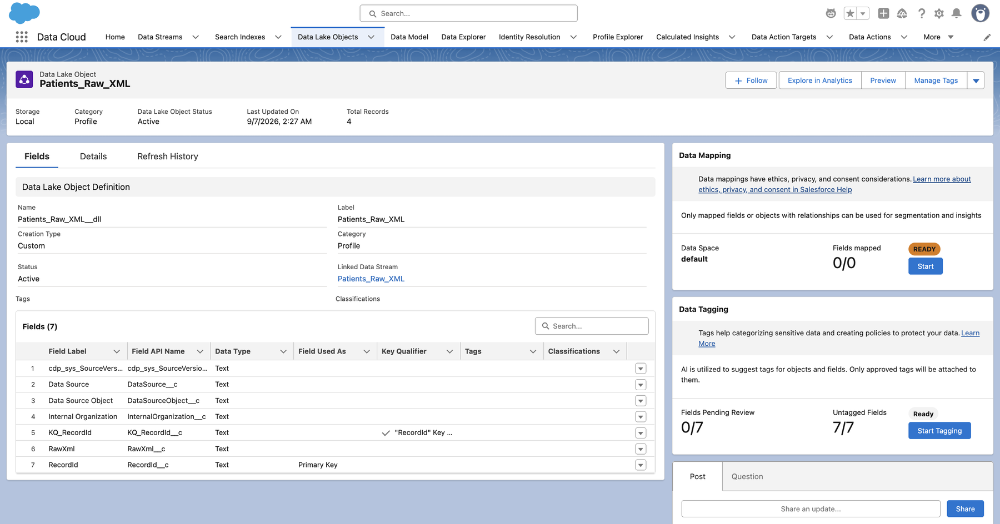
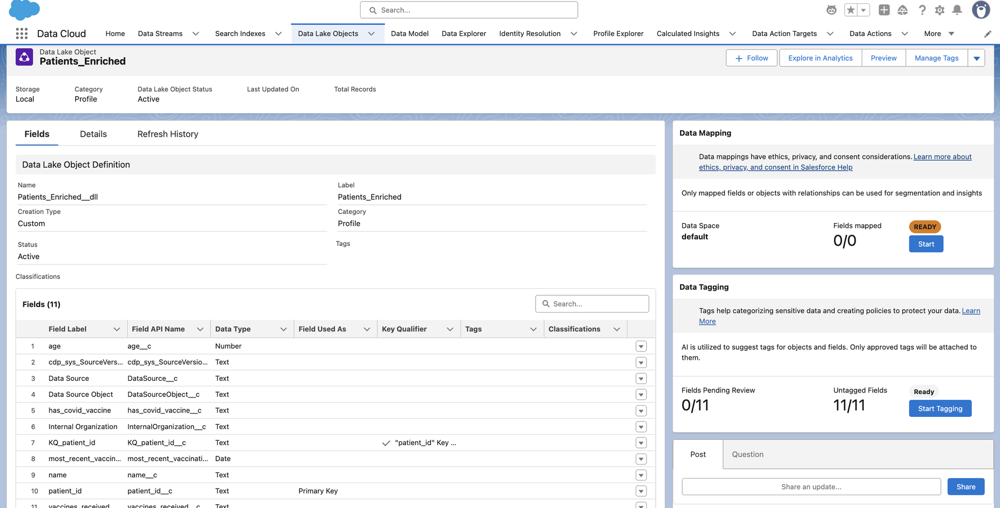

# 3. Prepare the data: source and target DLOs

[← 2. Authorize your org](02-authorize-org.md) · Next: [4. Run locally →](04-run-locally.md)

> **How to read the labels in this lab**
>
> - 🔧 **Technical:** the same for **any** Code Extension. Reuse it as it is in your own example.
> - 🩺 **Use case:** specific to this patient-XML example. Replace it with your own data, objects and logic.

Every Code Extension script needs two things in Data 360 before it can run: a **source DLO** to read from and a **target DLO** to write to. This page creates both for the patient example.

---

## The use case

🩺 **Use case:** specific to the patient example. Replace it in your own.

Vaccination records arrive as XML, one **clinic batch** per row, in a text field of a source DLO:

```xml
<ClinicBatch batchId="BATCH-NORTH-2024">
  <Patient>
    <PatientId>P-1001</PatientId>
    <Name>…</Name>
    <DateOfBirth>1955-04-18</DateOfBirth>
    <Vaccinations>
      <Vaccination><Vaccine>Influenza</Vaccine><Date>2024-10-05</Date></Vaccination>
      <Vaccination><Vaccine>Shingrix</Vaccine><Date>2023-06-01</Date></Vaccination>
    </Vaccinations>
  </Patient>
  <Patient>…</Patient>
</ClinicBatch>
```

In that shape you can't segment, filter or search the data. The script ([`payload/entrypoint.py`](../patient-xml-transform/payload/entrypoint.py)) reads every batch, parses the XML and writes **one row per `<Patient>`** to the target DLO, with these derived fields:

| Target field | How it's derived |
|---|---|
| `patient_id__c` | `<PatientId>` |
| `name__c` | `<Name>` |
| `age__c` | Whole years from `<DateOfBirth>` to today |
| `vaccines_received__c` | Every `<Vaccine>`, standardized (typo fixes, title case) and comma-separated |
| `most_recent_vaccination_date__c` | Latest `<Date>` (several date formats accepted) |
| `has_covid_vaccine__c` | `Yes` if any vaccine name contains "covid", otherwise `No` |

The sample file [`data/patients_raw_xml.csv`](../patient-xml-transform/data/patients_raw_xml.csv) has **4 batches** with **12 patients** in total. All of the data is fictional.

## The technical rules behind this page

🔧 **Technical:** the same for any Code Extension.

These apply to any example you build. The steps below show how the patient example follows them.

1. **A script reads DLOs and writes DLOs** (or DMOs to DMOs). You can't mix the two in one script.
2. **Both DLOs must be members of the same data space**, and `config.json` names that data space. If a DLO isn't in it, queries fail with `table "…__dll" does not exist`, even though you can see the DLO in the UI.
3. **Names get suffixes.** You name an object `Patients_Raw_XML`, and the API name is `Patients_Raw_XML__dll`. Fields get `__c`. Your code always uses the **API** names.
4. **Column names are lowercase in code.** The UI shows `RawXml__c`, and the script reads `rawxml__c`.
5. **Target field types must match what the script writes.** A text value can't be written into a Number field. The local run checks that the *columns exist* but **not their types**, so a wrong type only fails later, in the deployed run. You can't change a field's type after the DLO exists.
6. **Data 360 adds system fields automatically**, such as `DataSource__c`, `DataSourceObject__c`, `InternalOrganization__c`, `cdp_sys_SourceVersion__c` and a `KQ_…` key-qualifier field. Your script doesn't write them. That's why the DLOs below show 7 and 11 fields instead of 2 and 6.
7. **Governance tags on the target aren't inherited.** If your org uses data governance, assign tags to the target DLO **manually**.

Official reference: [Create Data Lake Objects](https://developer.salesforce.com/docs/data/data-cloud-code-ext/guide/create-dlos.html).

---

## Step 1: Load the sample data (source DLO)

🩺 **Use case:** specific to the patient example. Replace it in your own.

This step creates a data stream from a CSV file, which creates the source DLO. The file, the column names and the object name are specific to the patient example.

1. In Data 360, open **Data Streams → New** and choose **File Upload** as the source.
2. Upload `patient-xml-transform/data/patients_raw_xml.csv`.
3. Confirm that both columns are detected as **Text**: `RecordId` and `RawXml`.
4. Set **`RecordId`** as the **Primary Key**. We used the category **Profile**.
5. Name the Data Lake Object **`Patients_Raw_XML`**. Data 360 adds the suffix, so its API name becomes **`Patients_Raw_XML__dll`**.
6. Choose the **`default`** data space and deploy the stream.

When it finishes, open **Data Lake Objects → Patients_Raw_XML**. You should see this:



What to check in the screenshot:

- **Name:** `Patients_Raw_XML__dll`, with a **Linked Data Stream** of the same name.
- **Total Records:** **4**, one per clinic batch.
- **Data Space** (right panel): `default`.
- **Fields (7):** your two columns, `RecordId` (**Primary Key**) and `RawXml`, plus five system fields.

| Field (as shown in the UI) | Name in code | Type |
|---|---|---|
| `RecordId__c` | `recordid__c` | Text (Primary Key) |
| `RawXml__c` | `rawxml__c` | Text |

## Step 2: Create the target DLO

🩺 **Use case:** specific to the patient example. Replace it in your own.

The script writes its results here. The fields below are the output of the patient example, so for your own example you'd define your own.

Go to **Data Lake Objects → New** and create a DLO from scratch:

- **Object label:** `Patients Enriched`. **API name:** `Patients_Enriched`, which becomes `Patients_Enriched__dll`.
- **Category:** **Other**. (The original kit's screenshot shows **Profile**. Both categories exist in our test org.)
- **Fields:** create them exactly as below, including the types. Data 360 adds `__c` to each API name.

| Field API name | Type | Notes |
|---|---|---|
| `patient_id` | **Text** | **Primary Key** |
| `name` | **Text** | Must be Text, not Number. See the warning below |
| `age` | **Number** | |
| `vaccines_received` | **Text** | |
| `most_recent_vaccination_date` | **Date** | |
| `has_covid_vaccine` | **Text** | |

Then add the DLO to the data space: **Data Spaces → default → Add Data Lake Objects → `Patients_Enriched__dll`**. The source DLO is already in `default`, because you chose it in the data stream.



What to check in the screenshot:

- **Name:** `Patients_Enriched__dll`, with **Data Space** `default` in the right panel.
- **Fields (11):** your six (`age`, `has_covid_vaccine`, `most_recent_vaccination…`, `name`, `patient_id` and `vaccines_received`) plus five system fields.
- **Data Type** column: `age` is **Number**, `most_recent_vaccination…` is **Date**, and every other field of yours is **Text**.
- **Total Records** is empty: nothing has been written yet.

> ⚠️ **Field types matter, and the local run won't catch a wrong one.** If `name` is created as **Number**, the local run succeeds and the deployed transform fails later with `CANNOT_SAFELY_CAST`. You can't change a field's type after the DLO is created. Get it right now, or recreate the DLO.

> **Governance:** if your org uses data governance tags, assign them to `Patients_Enriched__dll` **manually**. Tags aren't yet propagated automatically from source to target objects.

> **You may face:** a field you created as `name` appears as `name__c`. That's expected, because DLO custom fields get the `__c` suffix. The script writes `name__c`.

## Check before you continue

🔧 **Technical:** the same for any Code Extension.

In **Data 360 → Query Editor**, with the `default` data space selected, run both queries. They return counts only.

```sql
SELECT COUNT(*) AS batches  FROM "Patients_Raw_XML__dll";   -- expected: 4
SELECT COUNT(*) AS patients FROM "Patients_Enriched__dll";  -- expected: 0 (nothing written yet)
```

| Result | Meaning |
|---|---|
| First query returns **4**, second returns **0** | Ready for [step 4](04-run-locally.md) |
| `table "…__dll" does not exist` for either | That DLO isn't in the `default` data space, or you're in a different org. See rule 2 above |
| First query returns **0** | The data stream hasn't finished loading. Wait and retry |

---

[← 2. Authorize your org](02-authorize-org.md) · Next: [4. Run locally →](04-run-locally.md)
