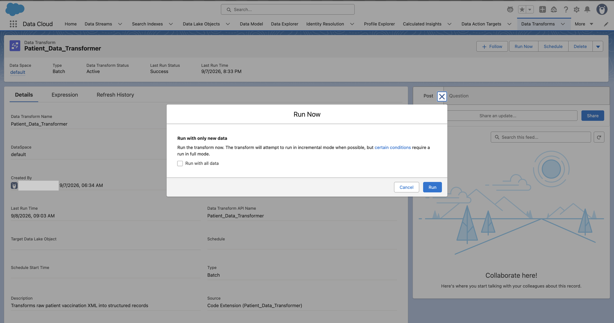
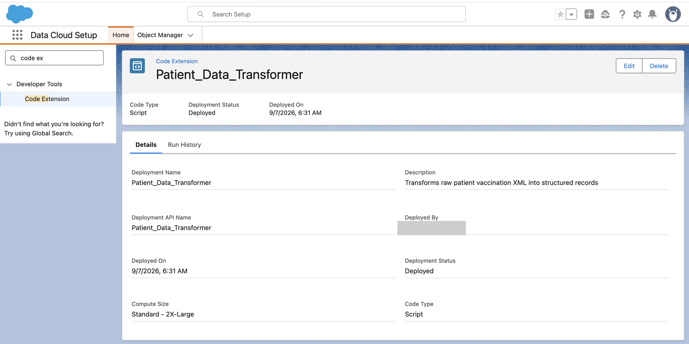
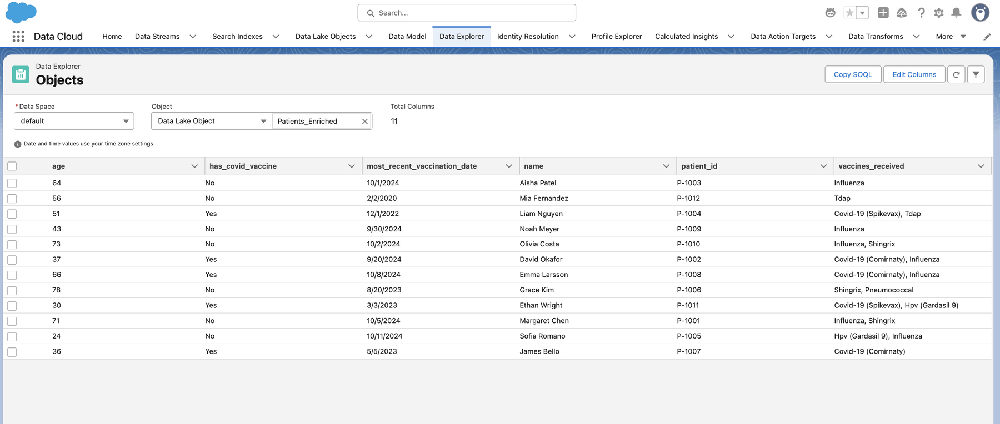

# 5. Package, deploy, run and monitor

[← 4. Run locally](04-run-locally.md) · Next: [Troubleshooting →](troubleshooting.md)

> **Labels:** 🔧 **Technical** = the same for any Code Extension. 🩺 **Use case** = specific to the patient-XML example. See [step 3](03-prepare-data.md) for the full legend. Almost everything on this page is 🔧. The only 🩺 parts are the names you choose when deploying and the expected results you validate.

This follows the official sequence from the [Quick Start](https://developer.salesforce.com/docs/data/data-cloud-code-ext/guide/quickstart.html): **scan → zip → deploy**, then run the batch data transform in Data 360. Every flag below was checked against `sf data-code-extension script <cmd> --help` (plugin 1.6.3).

Run everything from the **package folder**, with the environment active:

```bash
cd byoc && source ./env.sh && cd patient-xml-transform          # macOS
```
```powershell
cd byoc; . .\env.ps1; cd patient-xml-transform                   # Windows
```

## Step 1: Scan

🔧 **Technical:** the same for any Code Extension.

```bash
sf data-code-extension script scan --entrypoint ./payload/entrypoint.py
```

Scan reads your script without running it and rewrites two files:

- **`payload/config.json`**: it sets `entryPoint`, keeps `dataspace` (or sets `default` if it's empty) and rebuilds `permissions` from every `client.read_dlo(...)` and `client.write_to_dlo(...)` call. These permissions decide what the deployed code may read and write. Deploy also uses them to build the data transform, with sources = read and outputs = write.
- **`requirements.txt`**: it adds every third-party package your script imports (detected with `pipreqs`). `datacustomcode` and `pyspark` are excluded because the runtime provides them. For this lab the file stays empty, apart from its comment line.

Expected `config.json` after scanning:

```json
{
  "sdkVersion": "7.0.0",
  "entryPoint": "entrypoint.py",
  "dataspace": "default",
  "permissions": {
    "read":  { "dlo": ["Patients_Raw_XML__dll"] },
    "write": { "dlo": ["Patients_Enriched__dll"] }
  }
}
```

**Rerun scan every time you edit the script**, especially when you change a DLO name or add an import. Otherwise `config.json` still grants the old objects, and the deployed code can't read or write the new ones. To preview the changes without writing anything, add `--dry-run`.

> **You may face:** `Error (PipreqsScanError): Failed to scan imports using pipreqs`. `pipreqs` isn't installed in the venv. Run `uv pip install pipreqs`, or skip the requirements part with `--no-requirements`, which only updates `config.json`.
>
> **You may face:** `dataspace must be defined. Please add a 'dataspace' field to the config.json file.` The `dataspace` key is missing from `config.json`. Add `"dataspace": "default"` and scan again.
>
> **You may face:** permissions that look wrong or empty. Scan only finds DLO names written as string literals, or as variables assigned a literal (like `SOURCE_DLO = "…"` in this script). Names built at run time aren't detected. Edit `config.json` by hand in that case.

## Step 2: Zip (optional, but useful)

🔧 **Technical:** the same for any Code Extension.

```bash
sf data-code-extension script zip --package-dir ./payload
```

Expected output:

```
Creating package archive...... done
Skipping dependency archive: requirements.txt is missing or empty in …/patient-xml-transform
Archive created: deployment.zip
Files included: 2
Archive size: 1.88 KB
```

- `deployment.zip` is written to the **current folder** (`patient-xml-transform/`), not inside `payload/`. It's git-ignored.
- It contains everything under `payload/` except `.DS_Store`, symlinks and `external_callout_config.json`. Here that's `config.json` and `entrypoint.py`. List it with `tar -tf deployment.zip`, which works on macOS and on Windows 10 and later. If you also see `__pycache__/…`, created when something imported the script, delete `payload/__pycache__` and zip again. Deploy uploads whatever is in `payload/`.
- **Deploy rebuilds the zip itself**, so this step is only a check that the package builds, and a way to see what will be uploaded.

## Step 3: Deploy

🔧 **Technical:** the same for any Code Extension.

macOS:

```bash
sf data-code-extension script deploy \
  --name Patient_Data_Transformer \
  --package-version 1.0.0 \
  --description "Transforms raw patient vaccination XML into structured records" \
  --package-dir ./payload \
  --target-org byoc-org \
  --cpu-size CPU_L
```

Windows (one line, or end each line with a backtick):

```powershell
sf data-code-extension script deploy --name Patient_Data_Transformer --package-version 1.0.0 --description "Transforms raw patient vaccination XML into structured records" --package-dir .\payload --target-org byoc-org --cpu-size CPU_L
```

The deploy runs these steps in order:

```
Authenticating with Salesforce org '<user>'...... done
Deploying package to Salesforce org...
Creating deployment 'Patient_Data_Transformer'...          ← creates the Code Extension record
Building deployment package (deployment.zip)...         ← runs zip again
Uploading deployment package...
Waiting for deployment to complete...
Deployment status: Initializing                         ← one line per second; a few minutes is normal
…
Deployment status: Deployed
Creating data transform...                              ← scripts only
Package 'Patient_Data_Transformer' version '1.0.0' deployed successfully!
Data Code Extension deployment completed successfully!
```

**Deploy also creates the batch data transform.** For a script package, the CLI creates a batch data transform with the **same name** (`Patient_Data_Transformer`), in the data space from `config.json`. Its sources and outputs come from `permissions`. You don't need to create one by hand. The UI path is in Step 4.

### Flags

🩺 `--name` and `--description` are yours to choose, so use names that describe your own example. Everything else is 🔧 and stays the same.

| Flag | Notes |
|---|---|
| `--name` (`-n`) | Becomes the API name of the Code Extension **and** of its data transform. The CLI replaces spaces and hyphens with underscores and drops other symbols. Keep to the platform rules: letters, digits and single underscores; start with a letter; no trailing underscore; at most 40 characters. |
| `--package-version` | Required, but the CLI help says it's *reserved for future use*. Changing it does **not** update an existing deployment. See [Redeploying](#redeploying-a-new-version). |
| `--description` (`-d`) | Required, up to 255 characters. |
| `--package-dir` (`-p`) | The `payload` folder. |
| `--target-org` (`-o`) | Always `byoc-org`. |
| `--cpu-size` | `CPU_L`, `CPU_XL`, `CPU_2XL` or `CPU_4XL`. In plugin 1.6.3 the default is **`CPU_2XL`** (the docs page says `CPU_XL`, so check your plugin's `--help`). |

**CPU size and cost.** Larger sizes give more vCPUs and memory and *consume more credits*. The UI labels them Large, X-Large, 2X-Large and 4X-Large, at 4, 8, 16 and 32 compute units per hour. This lab parses 12 rows, so use **`CPU_L`**, the smallest. Check your contract and your org's consumption tracking for actual credit rates. In the REST API, the deployment's `computeType` shows an internal value (for example `CPU_XS` for `CPU_L`). That's expected.

> **You may face:** `This feature is not currently enabled for this user type or org: [CdpCustomCodeDeployment]`. Code Extension isn't enabled in **Feature Manager**. Enable it and run the deploy again. Nothing was created.
>
> **You may face:** `Error (DeploymentExists): Deployment Patient_Data_Transformer exists. Please use a different name.` A Code Extension with that name already exists, for example from an earlier attempt. See [Redeploying](#redeploying-a-new-version).
>
> **You may face:** a deploy that fails **after** `Creating deployment '…'`, during zip or upload. The deployment record already exists in the org, so the next attempt with the same name fails with `DeploymentExists`. Fix the cause first, then delete the half-created deployment ([Cleanup](#cleanup)) or deploy under a new name.
>
> **You may face:** `The deployment request returned no file upload URL`. The org or your user can't create Code Extension deployments. Check the Data Cloud Architect permission set and Feature Manager.
>
> **You may face:** `Deployment failed with status '…'`. The platform rejected the package. Open the deployment in the UI (Step 5) for details, fix the issue, then redeploy under a new name.
>
> **You may face:** `API name '…' must begin with a letter`. Change `--name` so it starts with a letter.

Official references: [Deploy Custom Script](https://developer.salesforce.com/docs/data/data-cloud-code-ext/guide/deploy-custom-script.html) · [Deploy with the CLI](https://developer.salesforce.com/docs/data/data-cloud-code-ext/guide/deploy-custom-script-cli.html).

### Redeploying a new version

With plugin 1.6.3, running `script deploy` again with the same `--name` fails with `DeploymentExists`, even if you change `--package-version`. To ship a code change, pick one of these:

- **New name (fastest):** deploy as `Patient_Data_Transformer_v2`. You get a second Code Extension **and** a second data transform. Run the new one, then delete the old pair when you're happy.
- **Same name:** delete the old data transform, then the old deployment ([Cleanup](#cleanup)), and deploy again with the original name.

Either way, **run `script scan` first** if you changed DLO names or imports.

## Step 4: Find (or create) the batch data transform

🔧 **Technical:** the same for any Code Extension.

1. Open **Data 360 → Data Transforms**.
2. Find **`Patient_Data_Transformer`**. Its source shows as **Code Extension**.

You only need to create a transform yourself if you deployed through the UI, or deleted the one the CLI made. To do that, go to **Data Transforms → New → Create From Code Extension → Next**, enter a **Data Transform Name** and **API Name**, select the `Patient_Data_Transformer` code extension, and save. Your user also needs Create, Read, Update and Delete on the **Data Custom Code Procedure Definitions** object.

Official reference: [Invoke Code Extension by Creating a Batch Data Transform](https://developer.salesforce.com/docs/data/data-cloud-code-ext/guide/create-batch-transform.html).

## Step 5: Run it and monitor it

🔧 **Technical:** the same for any Code Extension.

**Run:** in **Data Transforms**, click the triangle (▸) to the right of `Patient_Data_Transformer` and select **Run Now**, or open the transform and click **Run Now** at the top right. A dialog appears:



The dialog offers an incremental run ("Run with only new data", the default) or a full run (tick **Run with all data**). Our screenshot shows the default. The lab script reads the whole source DLO and overwrites the target, so it doesn't depend on which you pick. The first run takes a few minutes. Click **Run**.

**Monitor:** go to **Data Cloud Setup → Developer Tools → Code Extension** and click `Patient_Data_Transformer`.

- The **Details** tab shows Deployment Status (should be `Deployed`), Compute Size, Code Type and Deployed On.



  Our screenshot was taken with the default `CPU_2XL`, so it shows **Standard - 2X-Large**. With `CPU_L` the **Compute Size** should show **Standard - Large**. (We blurred the **Deployed By** user in the image.)

- The **Run History** tab shows one row per run, with Submitted Date, Called By, Run Status (`Running`, then `Success` or `Failure`), Rows Read and Rows Written. Click a Submitted Date to open the **Run Summary**.

The transform's own **Last Run Status** in Data Transforms shows the same outcome.

Official reference: [Monitor Deployments and Execution History](https://developer.salesforce.com/docs/data/data-cloud-code-ext/guide/view-deployment-details.html).

## Step 6: Validate the results

🩺 **Use case:** specific to the patient example. Replace it in your own.

These expected numbers belong to the patient example. Open **Data 360 → Query Editor**, choose the `default` data space and run the queries in [`queries/validate-results.sql`](../patient-xml-transform/queries/validate-results.sql). They return counts and IDs, not patient details.

| Query | Expected |
|---|---|
| `SELECT COUNT(*) FROM "Patients_Raw_XML__dll"` | **4** (clinic batches) |
| `SELECT COUNT(*) FROM "Patients_Enriched__dll"` | **12** (one row per patient), after a successful run |
| `… GROUP BY "has_covid_vaccine__c"` | **Yes = 5**, **No = 7** |

You can also look at the rows: open **Data Explorer**, choose the `default` data space, object type **Data Lake Object** and `Patients_Enriched`:



Each patient is now its own row, with the derived age, the standardized vaccine list, the latest vaccination date and the COVID flag. That is the whole point of the use case: these fields can now drive segments and filters.

The script writes with `WriteMode.OVERWRITE`, so running the transform again **replaces** the 12 rows instead of adding 12 more. The other write modes are `APPEND` (adds rows) and `MERGE` (updates matching keys and adds new ones).

From the CLI, the same counts come from the Data 360 Query API, using the JSON files in `queries/`:

```bash
sf api request rest "/services/data/v63.0/ssot/query-sql?dataspace=default" --method POST --body "@queries/count-patients.json" --target-org byoc-org
```

The command is the same in PowerShell. Keep the quotes around `"@queries/…"`.

## Step 7: Read the logs

🔧 **Technical:** the same for any Code Extension.

Everything your code prints, plus the runtime's own messages and Python tracebacks, lands in the **`DataCustomCodeLogs__dll`** DLO, one line per row. In **Query Editor**:

```sql
SELECT "Timestamp__c", "Message__c"
FROM "DataCustomCodeLogs__dll"
WHERE "DataCustomCodeName__c" = 'Patient_Data_Transformer'
ORDER BY "Timestamp__c" DESC
LIMIT 100;
```

Useful fields include `DataCustomCodeName__c` (Code Extension name), `ProcessDefinitionName__c` (transform name), `ExecutionId__c` (one value per run) and `Message__c`. To see only the last hour, add `AND "Timestamp__c" >= TIMESTAMPADD('minute', -60, CURRENT_TIMESTAMP)`.

From the CLI:

```bash
sf api request rest "/services/data/v63.0/ssot/query-sql?dataspace=default" --method POST --body "@queries/latest-logs.json"  --target-org byoc-org
sf api request rest "/services/data/v63.0/ssot/query-sql?dataspace=default" --method POST --body "@queries/errors-only.json" --target-org byoc-org
```

**Finding the root cause of a failed run.** A traceback is split over many rows, some of which hold just `^`. Look for the row that starts with `Failed to startup:`, or use `errors-only.json`. That row holds the real error. Two lines are normal and harmless: `Running code package version 1.0.0` and `DEBUG … Defaulting to script package type. SDK config file not found at /mnt/customer-code/.datacustomcode_proj/sdk_config.json`.

> ⚠️ **Data governance policies don't apply to the logs DLO.** Anyone with access to `DataCustomCodeLogs__dll` can read every line in it. Never `print()` or log record contents, PII or credentials. This script prints nothing. Keep it that way in your own code.

Official references: [Query logs in Query Editor](https://developer.salesforce.com/docs/data/data-cloud-code-ext/guide/query-logs-queryeditor.html) · [Query logs with the CLI](https://developer.salesforce.com/docs/data/data-cloud-code-ext/guide/query-logs-cli.html).

## Errors you may hit in the deployed run

🔧 **Technical:** the same for any Code Extension.

> **You may face:** Run Status `Failure`, and in the logs: `DLO write failed … [INCOMPATIBLE_DATA_FOR_TABLE.CANNOT_SAFELY_CAST] … Cannot safely cast 'name__c' "STRING" to "DECIMAL(38,18)"`. A target DLO field has the wrong type, here `name` created as **Number** instead of **Text**. The local run doesn't check types, so it passed. You can't change a DLO field's type, so: (1) delete the data transform; (2) delete `Patients_Enriched__dll` and recreate it with the types in [step 3, Step 2](03-prepare-data.md#step-2-create-the-target-dlo), then add it to the `default` data space; (3) create the transform again with **Create From Code Extension** (Step 4) and run it.
>
> **You may face:** Run Status `Failure` with `Column '…' not found` or `does not exist`. The deployed code reads or writes an object or column that isn't in `config.json`'s permissions, or uses mixed-case column names. Rerun `script scan`, fix the code and redeploy under a new name.
>
> **You may face:** the run succeeds but `Patients_Enriched__dll` is empty in Query Editor. You're querying a different data space, or the query ran before the write finished. Select `default` in Query Editor and run it again after Run Status shows `Success`.

## Cleanup

🔧 **Technical:** the same for any Code Extension.

1. **Data transform:** in **Data Transforms**, use the triangle menu (▸) on `Patient_Data_Transformer` → **Delete**. Delete it first: the Code Extension can't be deleted while something still references it.
2. **Code Extension:** in **Data Cloud Setup → Developer Tools → Code Extension**, use the arrow next to `Patient_Data_Transformer` → **Delete** → confirm. **You can't undo this.** There's no CLI command for it.
3. Optionally, delete the two DLOs and the data stream.

Official reference: [Delete Deployment](https://developer.salesforce.com/docs/data/data-cloud-code-ext/guide/delete-deployed-code.html).

---

[← 4. Run locally](04-run-locally.md) · Next: [Troubleshooting →](troubleshooting.md)
